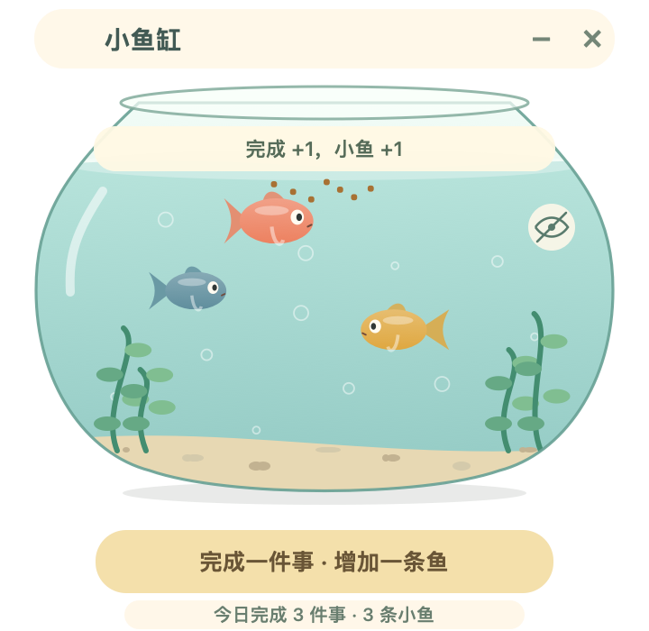
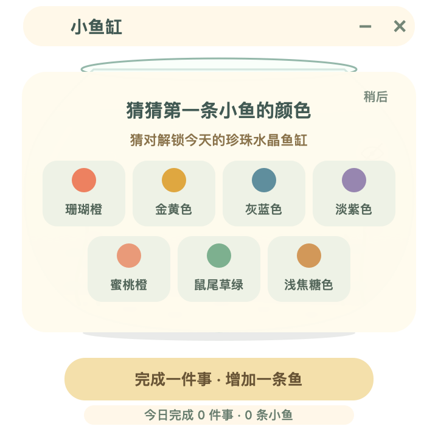
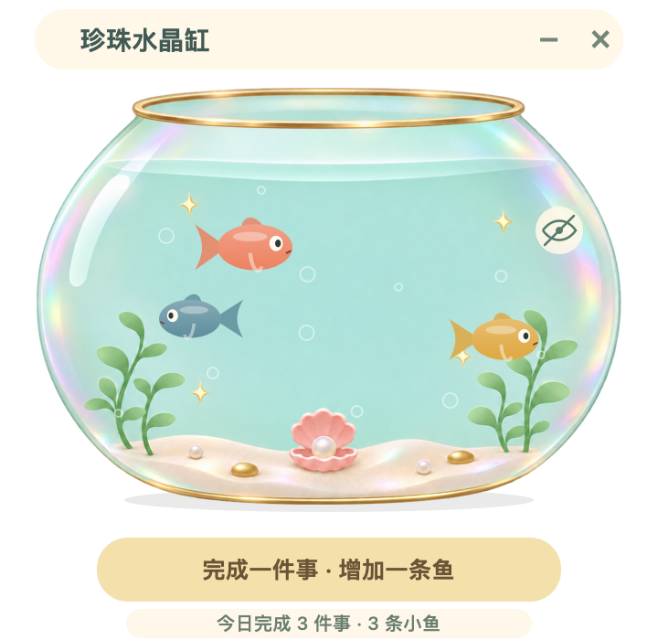

# 小鱼缸 · Little Aquarium

> 完成一件事，桌面上就多一条小鱼。

小鱼缸是一款原生 macOS 桌面应用。回完一封邮件、写完一段代码，或者终于做完一件拖了很久的小事，都可以点一下鱼缸，让一条小鱼游进来。一天过到哪儿了，抬眼看看鱼缸就知道。

[下载 macOS 体验版](https://github.com/christygyzhang/little-aquarium/releases)

## 怎么玩

- **做完一件事，添一条鱼。** 点鱼缸、点「完成」，或者从菜单栏记录。也可以给小鱼投喂。

  

- **每天猜一次鱼的颜色。** 当天第一次记录完成时，可以猜第一条小鱼是什么颜色。猜对了，当天就能换上珍珠水晶鱼缸。

  | 猜猜第一条小鱼的颜色 | 猜对后解锁珍珠水晶鱼缸 |
  | :---: | :---: |
  |  |  |

- **每天早上开启新一轮。** 鱼缸在北京时间早上 9:00 重置，过了午夜也还能接着养。关掉应用再打开，本轮的小鱼和竞猜结果会自动恢复。

## 把鱼缸放在顺眼的地方

透明鱼缸可以拖到桌面喜欢的位置，在迷你和标准尺寸之间切换，也能暂停小鱼游动。想安静看鱼时，点一下眼睛图标，就能收起文字和操作栏。

小鱼缸在菜单栏运行。用菜单栏的小鱼图标，或按 `⌘⇧H`，就能随时显示或隐藏鱼缸。

## 下载与安装

**系统要求** · 搭载 Apple 芯片（Apple Silicon）的 Mac，运行 macOS 13 Ventura 或更新版本。

前往 [GitHub Releases](https://github.com/christygyzhang/little-aquarium/releases) 下载 `.dmg`，打开后将「小鱼缸.app」拖入「应用程序」。

当前是早期体验版，尚未使用 Apple Developer ID 签名，也未经过 Apple 公证。首次打开的说明见发布页。

## 隐私与反馈

无需注册账号，应用离线运行，鱼缸进度和显示偏好只保存在本机。[隐私说明](PRIVACY.md)

遇到问题，或者有想加进鱼缸的小点子，欢迎在 [Issues](https://github.com/christygyzhang/little-aquarium/issues) 留言。
