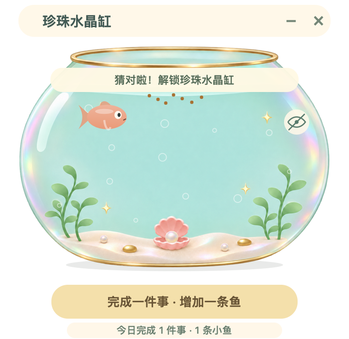

# 小鱼缸 · Little Aquarium

在 Mac 桌面养一缸小鱼。完成一件事，就给自己增加一条鱼。

## 下载

前往 **[下载页面](https://github.com/christygyzhang/little-aquarium/releases)**，在最新版本的 **Assets** 中下载 `Little-Aquarium-1.0.0-universal.dmg`。

- 系统要求：macOS 13 Ventura 或更新版本。
- 安装包包含 Apple 芯片和 Intel 两种架构；Intel Mac 兼容性仍需实机反馈。
- 这是早期体验版，暂未使用 Apple Developer ID 签名，也未完成 Apple 公证，首次打开可能被系统拦截。
- 此仓库用于发布安装包、使用说明和收集反馈，暂不包含应用源码。

## 安装与首次打开

1. 打开下载的 `.dmg`，将「小鱼缸.app」拖入「Applications」。
2. 在「应用程序」中双击「小鱼缸」。
3. 如果系统提示无法验证开发者，且你确认安装包来自本仓库、文件未被篡改，可在尝试打开后进入「系统设置 → 隐私与安全性」，点击「仍要打开」并确认。

首次打开说明参考 [Apple 官方指南](https://support.apple.com/zh-cn/102445)。如果系统报告恶意软件或文件损坏，请停止安装并反馈。安装时无需关闭系统安全保护，也无需运行终端命令。

也可下载 `.zip`，解压后将应用拖入「应用程序」。不要下载 GitHub 自动提供的 `Source code` 压缩包来安装应用。

## 玩法

- **完成一件事，增加一条鱼**：点击鱼缸、完成按钮，或菜单栏中的相应选项。
- **每天猜一次颜色**：当天第一次完成时，猜第一条鱼的颜色。猜对后，当天解锁珍珠水晶鱼缸。
- **每天早上 9:00 清零**：按北京时间（UTC+8）开始新的一轮；凌晨仍属于上一轮。
- **进度自动保存**：退出再打开，恢复本轮的小鱼、颜色顺序和竞猜结果。
- **桌面陪伴**：拖动鱼缸移动位置，通过菜单栏切换迷你 / 标准尺寸、暂停游动。
- **纯鱼缸模式**：点击眼睛按钮隐藏文字和操作栏；将鼠标移到鱼缸上可再次显示眼睛按钮。

| 操作 | 方法 |
| --- | --- |
| 显示 / 隐藏鱼缸 | `⌘ ⇧ H`，或菜单栏小鱼图标 |
| 隐藏窗口 | 右上角 `−` |
| 退出 | 右上角 `×`，或菜单栏「退出小鱼缸」 |
| 增加一条鱼 | 点击鱼缸、完成按钮，或菜单栏操作 |

小鱼缸在菜单栏运行，不显示 Dock 图标。全局快捷键被其他应用占用时，可使用菜单栏控制。

## 隐私与更新

应用无需注册账号，不收集或上传个人信息。进度和显示偏好保存在本机；应用本身没有联网、统计或广告功能。详情见 [隐私说明](PRIVACY.md)。

当前版本需要手动更新：退出旧版，下载新版并替换「应用程序」中的小鱼缸。替换应用通常不会清除保存在本机的进度。

## 反馈

欢迎在 [Issues](https://github.com/christygyzhang/little-aquarium/issues) 提交问题或建议。报告问题时请附上 macOS 版本、芯片类型、复现步骤；避免上传个人敏感信息。
